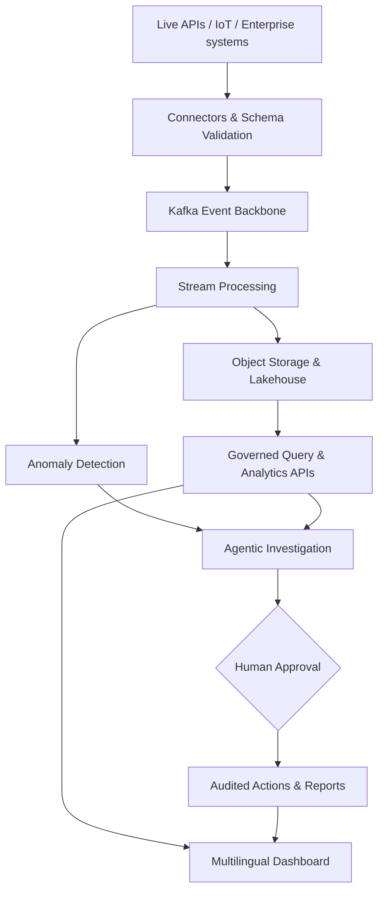

# DataNexus AI Enterprise

**Enterprise Big Data, Generative AI, Agentic AI, Cloud Infrastructure, Security & Governance Platform**

> **Project status:** Architecture and engineering foundation. Production deployment, benchmarks, and end-to-end implementation are **not yet complete**. This repository distinguishes targets from verified outcomes.

## Mission
Build a secure, reproducible, cloud-native platform for real-time and batch data processing, governed AI investigation, multilingual analytics, and evidence-backed human decisions.

## First complete vertical slice
1. Collect permitted near-real-time aviation state vectors from OpenSky (respecting credits and licensing).
2. Normalize and validate events; publish versioned events to Kafka.
3. Apply streaming transformations, quality gates, deduplication and late-event handling.
4. Write raw/curated datasets to an object-storage lakehouse.
5. Detect anomalies with transparent rules, then compare with ML baselines.
6. Trigger a bounded LangGraph investigation with read-only tools and citations.
7. Require a human reviewer for any proposed operational action.
8. Display pipeline health and investigation evidence; retain an audit trail.
9. Validate authorization, recovery, load, quality and infrastructure cost.

## Target architecture

**Cross-cutting concerns:** SSO, least privilege, tenant isolation, data classification, lineage, secrets, encryption, observability, evaluation and disaster recovery.

## Repository map
- [Documentation index](docs/INDEX.md)
- [Project vision](docs/01-strategy-and-business/project-vision.md)
- [Business requirements](docs/01-strategy-and-business/business-requirements.md)
- [Requirements specification](docs/02-requirements/software-requirements-specification.md)
- [Enterprise architecture](docs/03-enterprise-architecture/architecture-overview.md)
- [Data architecture](docs/04-data-architecture/data-platform.md)
- [Engineering standards](docs/05-software-engineering/engineering-standards.md)
- [Generative AI](docs/06-generative-ai/genai-architecture.md)
- [Agentic AI](docs/07-agentic-ai/agentic-architecture.md)
- [ML lifecycle](docs/08-machine-learning/ml-lifecycle.md)
- [Cloud reference](docs/09-cloud-infrastructure/cloud-reference.md)
- [Security](docs/10-security-governance/security-and-threat-model.md)
- [Test strategy](docs/11-testing-evaluation/test-strategy.md)
- [Operations](docs/12-production-operations/operations-readiness.md)
- [Benchmarks](docs/13-research-benchmarks/benchmark-protocol.md)
- [Roadmap](docs/01-strategy-and-business/roadmap.md)
- [Architecture decisions](architecture/adr/ADR-001-event-backbone.md)

## Engineering quality gates
Requirements IDs map to API/event contracts, automated tests and evidence. Never label a design-only control as implemented. All workloads must have documented permissions, resource budgets, failure behavior and observable health.

## Planned implementation stack
Python/FastAPI, TypeScript/Next.js, Kafka, Flink or Spark, Iceberg-compatible lakehouse, PostgreSQL, Redis, LangGraph, model gateway, OpenTelemetry, Docker, Terraform and a staged Kubernetes deployment. Technology decisions are recorded in ADRs and may be revised after testing.

## Development status
| Area | Status |
|---|---|
| Vision, scope, requirements | Initial baseline |
| Architecture & ADRs | Initial baseline |
| API/event contracts | Draft schema |
| Streaming data pipeline | Planned |
| GenAI/agentic orchestration | Planned |
| End-to-end security evidence | Not yet validated |
| Production availability | Not claimed |

## Licensing and data
Verify terms for each external data provider before collection, retention, publication or commercial use. Never commit credentials, personal data, proprietary data or unlicensed datasets.

See [CONTRIBUTING.md](CONTRIBUTING.md) and [SECURITY.md](SECURITY.md).
