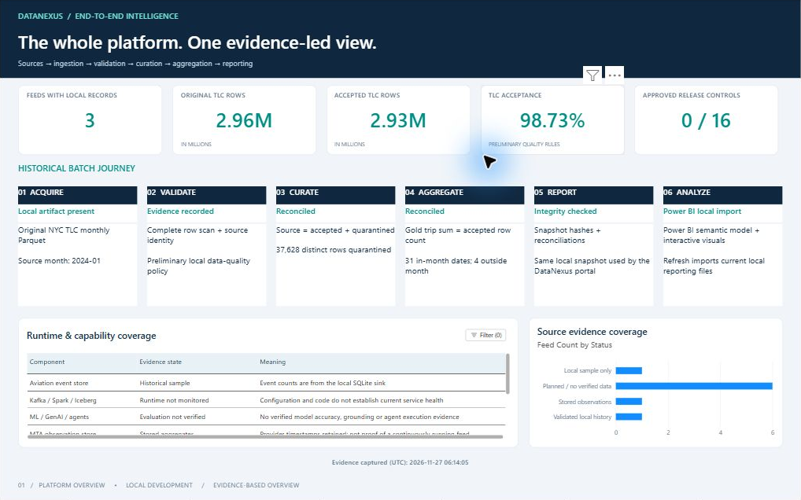
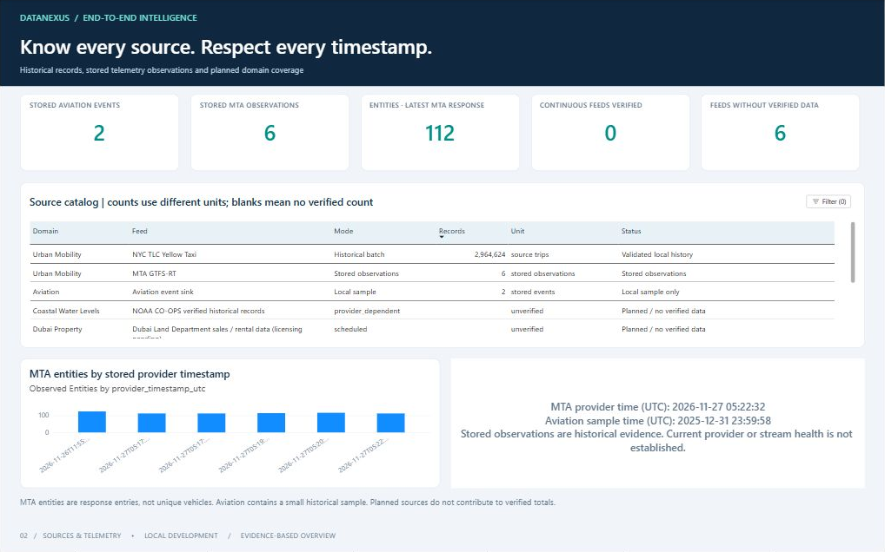
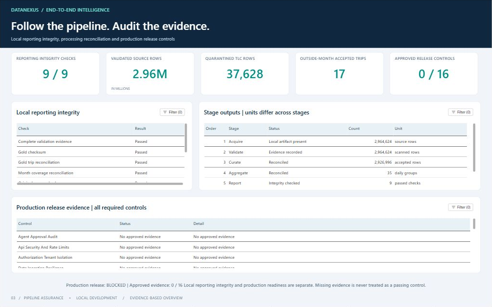
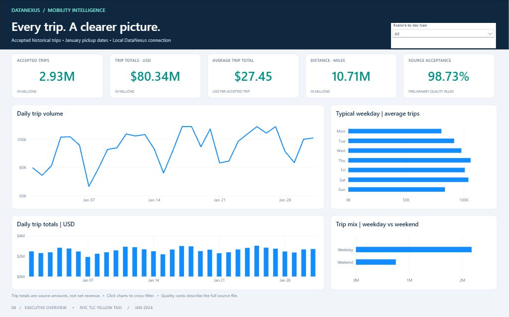
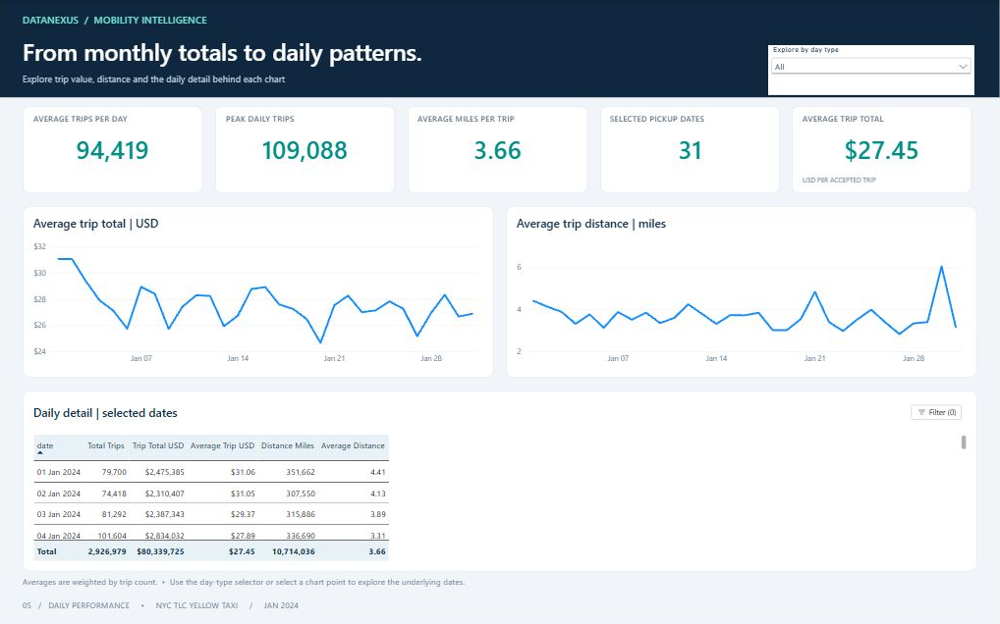
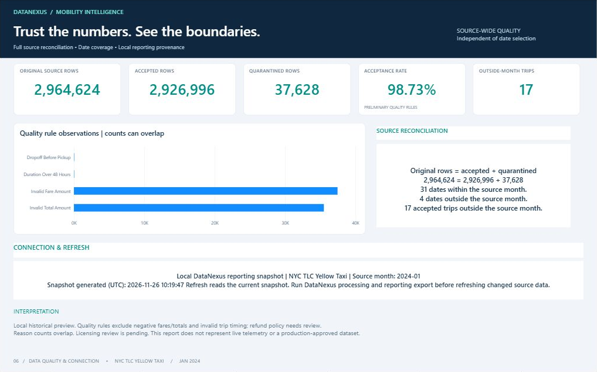
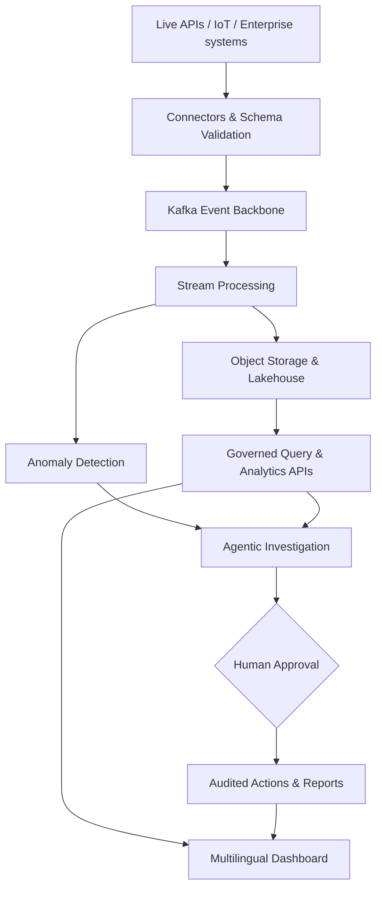

# DataNexus AI Enterprise

**Enterprise Big Data, Generative AI, Agentic AI, Cloud Infrastructure, Security & Governance Platform**

> **Project status:** Architecture and engineering foundation. Production deployment, benchmarks, and end-to-end implementation are **not yet complete**. This repository distinguishes targets from verified outcomes.

## Mission
Build a secure, reproducible, cloud-native platform for real-time and batch data processing, governed AI investigation, multilingual analytics, and evidence-backed human decisions.

<!-- powerbi-report-gallery:start -->
## Power BI data analysis report

The [editable Power BI project](dashboards/powerbi) shows local DataNexus reporting
evidence, processing reconciliation, quality checks and historical trip analysis.
It also includes domain coverage, Earth and water observations, and energy and
Dubai property pages. Use the [connection guide](docs/13-powerbi/data-connection-first.md)
to load the available local snapshots. The gallery below shows the six original pages.

**Screenshots captured: 27 November 2026.** The taxi analysis covers **January
2024 pickup dates**; these are historical snapshots, not live telemetry.
The taxi reporting snapshot was generated on 26 November 2026 at 10:19 UTC;
the platform evidence snapshot was captured on 27 November 2026 at 06:14 UTC.

| Analysis measure | Value shown |
|---|---:|
| Original NYC TLC source rows | 2,964,624 |
| Accepted trips with January pickup dates | 2,926,979 |
| January source trip totals | $80.34 million USD |
| Weighted average trip total | $27.45 USD |
| Source-wide quality acceptance | 98.73% |
| Local reporting integrity checks | 9 / 9 passed |

Trip totals are amounts in the source records, **not net business revenue**.
Passing local reporting checks does not approve a production release: the
dashboard separately shows **0 / 16 approved production controls**.

### 1. Platform overview

Three feeds have local records. The batch journey traces acquisition,
validation, curation, aggregation and reporting, while unverified runtime
components remain explicitly labelled.

### 2. Sources and telemetry

The catalog distinguishes historical taxi data, six stored MTA observations,
the two-event aviation sample and planned sources. The latest stored MTA
response contains 112 entities; these are response entries, not unique vehicles
or proof of a continuously running feed.

### 3. Pipeline assurance

Nine reporting integrity checks pass, including source and derived-file checksums
and row reconciliation. Stage outputs use different units, and production
release evidence is assessed separately.

### 4. Taxi executive analysis

January trip volume, source trip amounts, weighted trip value, distance,
weekday patterns and weekday/weekend mix appear together in the executive view.

### 5. Daily performance

The selected month contains 31 pickup dates, an average of 94,419 accepted trips
per day and a peak daily count of 109,088. Per-trip amount and distance averages
are weighted by trip count.

### 6. Data quality and reconciliation

The original source reconciles to 2,926,996 accepted rows plus 37,628 quarantined
rows. Seventeen accepted trips fall outside January and are excluded from the
January analysis. Quality-reason counts overlap and must not be summed as
distinct rejected rows.

Open [the Power BI project and refresh instructions](dashboards/powerbi/README.md)
for interactive filtering and local data setup. These README images are static;
the dashboard save-to-GitHub watcher updates project definitions, not screenshot
images. No raw datasets, imported model caches or credentials are included here.
<!-- powerbi-report-gallery:end -->

## First complete vertical slice
1. Collect permitted near-real-time aviation state vectors from OpenSky (respecting credits and licensing).
2. Normalize and validate events; publish versioned events to Kafka.
3. Apply streaming transformations, quality gates, deduplication and late-event handling.
4. Write raw/curated datasets to an object-storage lakehouse.
5. Detect anomalies with transparent rules, then compare with ML baselines.
6. Trigger a bounded LangGraph investigation with read-only tools and citations.
7. Require a human reviewer for any proposed operational action.
8. Display pipeline health and investigation evidence; retain an audit trail.
9. Validate authorization, recovery, load, quality and infrastructure cost.

## Target architecture

**Cross-cutting concerns:** SSO, least privilege, tenant isolation, data classification, lineage, secrets, encryption, observability, evaluation and disaster recovery.

## Repository map
- [Documentation index](docs/INDEX.md)
- [Project vision](docs/01-strategy-and-business/project-vision.md)
- [Business requirements](docs/01-strategy-and-business/business-requirements.md)
- [Requirements specification](docs/02-requirements/software-requirements-specification.md)
- [Enterprise architecture](docs/03-enterprise-architecture/architecture-overview.md)
- [Data architecture](docs/04-data-architecture/data-platform.md)
- [Engineering standards](docs/05-software-engineering/engineering-standards.md)
- [Generative AI](docs/06-generative-ai/genai-architecture.md)
- [Agentic AI](docs/07-agentic-ai/agentic-architecture.md)
- [ML lifecycle](docs/08-machine-learning/ml-lifecycle.md)
- [Cloud reference](docs/09-cloud-infrastructure/cloud-reference.md)
- [Security](docs/10-security-governance/security-and-threat-model.md)
- [Test strategy](docs/11-testing-evaluation/test-strategy.md)
- [Operations](docs/12-production-operations/operations-readiness.md)
- [Benchmarks](docs/13-research-benchmarks/benchmark-protocol.md)
- [Roadmap](docs/01-strategy-and-business/roadmap.md)
- [Architecture decisions](architecture/adr/ADR-001-event-backbone.md)

## Production completion gate

The [production completion contract](docs/12-production-operations/production-completion-contract.md)
defines 16 mandatory evidence-based release controls. Run
`python scripts/release_gate.py`; it **intentionally blocks release** until
all controls have independent evidence and review. This is not currently a
production-complete system.

## Engineering quality gates
Requirements IDs map to API/event contracts, automated tests and evidence. Never label a design-only control as implemented. All workloads must have documented permissions, resource budgets, failure behavior and observable health.

## Planned implementation stack
Python/FastAPI, TypeScript/Next.js, Kafka, Flink or Spark, Iceberg-compatible lakehouse, PostgreSQL, Redis, LangGraph, model gateway, OpenTelemetry, Docker, Terraform and a staged Kubernetes deployment. Technology decisions are recorded in ADRs and may be revised after testing.

## Development status
| Area | Status |
|---|---|
| Vision, scope, requirements | Initial baseline |
| Architecture & ADRs | Initial baseline |
| API/event contracts | Draft schema |
| Streaming data pipeline | Planned |
| GenAI/agentic orchestration | Planned |
| End-to-end security evidence | Not yet validated |
| Production availability | Not claimed |

## Licensing and data
Verify terms for each external data provider before collection, retention, publication or commercial use. Never commit credentials, personal data, proprietary data or unlicensed datasets.

See [CONTRIBUTING.md](CONTRIBUTING.md) and [SECURITY.md](SECURITY.md).