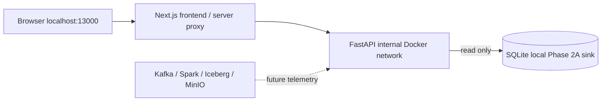

# Phase 3A.1 — Premium enterprise UI / local working vertical slice

## What is implemented
- Responsive, premium dark-sidebar/light-surface Next.js portal
- Navigation for overview, aviation intelligence, pipelines, quality,
  AI operations (future), and environment settings
- Local FastAPI read-only event queries against Phase 2A SQLite
- Server-side Next.js API proxy, query allowlist and no wildcard CORS
- Aviation map schematic with geographic coordinate markers, event table,
  search/sort, details drawer, JSON download, loading/error states
- Data source labels and explicit missing live telemetry indication

## What is not implemented
- Production SSO, RBAC, service-to-service authentication
- Public cloud deployment, PostgreSQL, migrations, advanced search
- Live Kafka/Spark/Iceberg instrumentation, end-to-end data lineage
- Real-time aircraft map tile service, ML and governed agents
- Frontend browser-based QA (requires user's Windows Docker run)

## Architecture

## Local run / testing
See [apps/README.md](../../apps/README.md).

Do not confuse Phase 3A.1 with a production release. The portal displays
its authenticated identity status truthfully as 'Unauthenticated prototype'
and disables fabricated business metrics.
